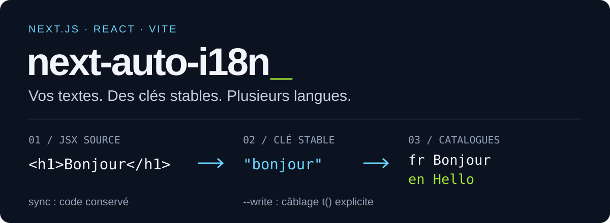

# next-auto-i18n

**Passez de vos textes JSX à des catalogues traduits, puis câblez `t()` à votre rythme.**

[](https://www.npmjs.com/package/next-auto-i18n)
[](https://github.com/stvekoulo/auto-i18n/actions/workflows/ci.yml)
[](https://github.com/stvekoulo/auto-i18n/actions/workflows/compatibility.yml)
[](./LICENSE)

<p align="center">
  
</p>

Un CLI pour **Next.js App Router** et **React/Vite** : il extrait les textes, réutilise les clés existantes et traduit uniquement ce qui manque avec DeepL ou Google Translate. `sync` conserve vos composants ; `sync --write` peut ensuite câbler les cas sûrs avec sauvegarde.

```tsx
// Texte détecté dans votre composant
<h1>Bonjour</h1>

// Câblage proposé par le guide, ou appliqué avec --write
<h1>{t("bonjour")}</h1>
```

```text
messages/fr.json                    messages/en.json
{ "bonjour": "Bonjour" }            { "bonjour": "Hello" }
```

## Premier essai

Node.js **22.13 minimum**. Lancez les commandes à la racine de votre application.

```bash
# Next.js App Router
npm install -D next-auto-i18n
npm install next-intl

npx next-auto-i18n init --source fr --locale en,es
```

Pour React/Vite, installez `i18next react-i18next` à la place de `next-intl`.

`init` demande la clé API, crée la configuration et l’infrastructure manquante, remplit les catalogues puis écrit **`i18n-guide.md`**. La clé est stockée dans `.env.local`, ajouté à `.gitignore`. Une configuration déjà présente est préservée : utilisez ensuite `sync`.

Sur Next.js, suivez le guide pour le layout de locale et `NextIntlClientProvider`. Sur React/Vite, le scaffold initialise i18next et importe sa configuration dans le point d’entrée reconnu.

## La boucle du quotidien

| Commande                                        | Résultat                                                                         |
| ----------------------------------------------- | -------------------------------------------------------------------------------- |
| `npx next-auto-i18n sync`                       | Ajoute les textes nouveaux et traduit les clés manquantes.                       |
| `npx next-auto-i18n sync --dry-run`             | Aperçu des catalogues, sans écriture ni appel de traduction.                     |
| `npx next-auto-i18n sync --write --dry-run`     | Affiche aussi le diff des composants éligibles.                                  |
| `npx next-auto-i18n sync --write`               | Câble les cas sûrs avec une sauvegarde par fichier.                              |
| `npx next-auto-i18n sync --prune --dry-run`     | Prévisualise la suppression des clés devenues inutiles.                          |
| `npx next-auto-i18n check --json`               | Diagnostic pour la CI ; code de sortie non nul si une correction est nécessaire. |
| `npx next-auto-i18n languages --provider deepl` | Liste les langues acceptées par le provider.                                     |

### Ce qui rend les passages répétés sûrs

- **Clés stables.** Une traduction existante est réutilisée ; les collisions de clés sont désambiguïsées.
- **Aperçu complet.** `--dry-run` n’écrit aucun catalogue, composant ou backup et ne traduit rien.
- **Câblage conservateur.** Les paramètres, masquages de `t`, namespaces et imports ambigus restent au guide. Les composants serveur Next.js doivent déjà être `async` ; les hooks React restent synchrones.
- **Purge prudente.** Les références déjà câblées sont préservées, y compris dans les autres dossiers applicatifs. Les clés dynamiques neutralisent la purge ; une erreur de scan l’arrête.
- **Écritures protégées.** Un verrou empêche deux opérations simultanées sur le projet. Les catalogues sont remplacés atomiquement, fichier par fichier.
- **Messages vérifiés.** Les réponses incomplètes, variables perdues et messages ICU invalides font échouer la commande ; les autres traductions valides sont conservées.

## Frameworks et compatibilité

| Application        | Infrastructure                                                                       | `--write`                                                        |
| ------------------ | ------------------------------------------------------------------------------------ | ---------------------------------------------------------------- |
| Next.js App Router | next-intl, configuration de requête, routing, switcher et `proxy.ts` sur Next.js 16+ | Composants client et fonctions serveur déjà `async`.             |
| React / Vite       | i18next + react-i18next, catalogues importés et switcher                             | Composants et hooks synchrones à corps de fonction identifiable. |

Les versions effectivement compilées et testées sont détaillées dans la [matrice de compatibilité](./COMPATIBILITY.md). La CI vérifie aussi régulièrement les versions publiées les plus récentes.

Le scaffold ajoute les fichiers manquants. Il ne restructure pas automatiquement les routes Next.js, ne remplace pas un fichier existant et ne devine pas le bon contexte pour chaque texte. Les cas ambigus restent documentés dans le guide.

Les catalogues sont **à plat**. Next.js utilise ICU MessageFormat ; le scaffold React configure l’interpolation simple `{name}`. Les pluriels natifs i18next utilisent leurs propres clés `_one` / `_other` et demandent une adaptation explicite.

## Configuration

`auto-i18n.config.json` — seuls `sourceLocale` et `targetLocales` sont requis :

```json
{
  "$schema": "https://raw.githubusercontent.com/stvekoulo/auto-i18n/main/schema/auto-i18n.config.schema.json",
  "sourceLocale": "fr",
  "targetLocales": ["en", "es"],
  "provider": "deepl",
  "messagesDir": "./messages",
  "rootDirs": ["app", "src", "components"],
  "ignore": ["**/*.test.*", "**/*.spec.*"]
}
```

`provider` accepte `deepl` ou `google`. La variable de clé est déduite du provider (`AUTO_I18N_DEEPL_KEY` ou `AUTO_I18N_GOOGLE_KEY`) et peut être personnalisée avec `apiKeyEnv`.

Sans `rootDirs`, le scan cherche dans les dossiers applicatifs usuels. Renseignez ce champ si votre code vit ailleurs. Le schéma active l’autocomplétion dans les éditeurs ; une configuration invalide arrête la commande avec la liste des problèmes.

## Dans un script

```ts
import { runCheck, runSyncCommand } from 'next-auto-i18n';

await runSyncCommand({ projectRoot: process.cwd(), dryRun: true });
const { report, exitCode } = await runCheck({ projectRoot: process.cwd() });
process.exitCode = exitCode;
```

L’import de la bibliothèque ne lance pas le CLI. Les pipelines acceptent aussi un provider personnalisé pour les intégrations et les tests.

## Documentation et contribution

- [Documentation complète](./DOCUMENTATION.md) — extraction, providers, API et limites.
- [Migration](./MIGRATION.md) — adaptations pour une installation existante.
- [Changelog](./CHANGELOG.md) — changements par version.
- [Compatibilité](./COMPATIBILITY.md) — versions vérifiées et procédure reproductible.
- [Sécurité](./SECURITY.md) — signalement et traitement des dépendances.

```bash
git clone https://github.com/stvekoulo/auto-i18n.git
cd auto-i18n
npm ci
npm run build
npm run test:coverage
npm run test:compat
```

Le projet sépare la logique pure (`core`), les entrées/sorties (`adapters`) et l’orchestration (`pipeline`, `commands`). Les vérifications de compatibilité installent le paquet assemblé dans de vraies applications Next.js et Vite.

## Licence

[MIT](./LICENSE) — Steven KOULO.
