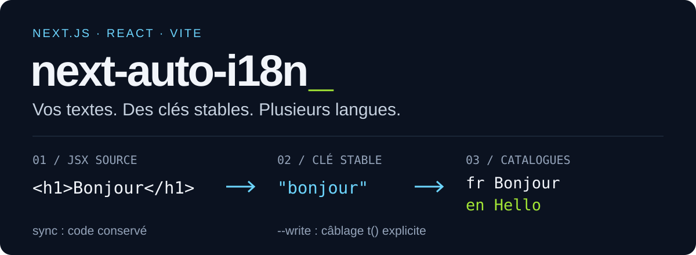

# next-auto-i18n

**Passez de vos textes JSX à des catalogues traduits, puis câblez `t()` à votre rythme — sur Next.js, React/Vite et Expo.**

[](https://www.npmjs.com/package/next-auto-i18n)
[](https://github.com/stvekoulo/auto-i18n/actions/workflows/ci.yml)
[](https://github.com/stvekoulo/auto-i18n/actions/workflows/compatibility.yml)
[](./LICENSE)

<p align="center">
  
</p>

Un CLI i18n pour **Next.js App Router**, **React / Vite** et **Expo / React Native** : il extrait les textes via le compilateur TypeScript officiel, détecte les modifications des textes source existants, et traduit uniquement le nécessaire avec **DeepL**, **Google Translate**, **Gemini**, **OpenAI** ou **Anthropic Claude** (avec contexte UI et glossaire). `sync` conserve vos composants ; `sync --write` câble les cas sûrs.

## Premier essai

Node.js **22.13 minimum**. Lancez les commandes à la racine de votre application :

```bash
# Next.js App Router
npm install -D next-auto-i18n
npm install next-intl

npx next-auto-i18n init --source fr --locale en,es
```

- **React / Vite :** installez `i18next react-i18next`.
- **Expo / React Native :** installez `npx expo install expo-localization i18next react-i18next`.

`init` demande le provider et la clé API, crée la configuration et l'infrastructure manquante, remplit les catalogues puis écrit **`i18n-guide.md`**. La clé est enregistrée dans `.env.local` (ajouté à `.gitignore`).

## La boucle du quotidien

| Commande                                        | Résultat                                                                              |
| ----------------------------------------------- | ------------------------------------------------------------------------------------- |
| `npx next-auto-i18n sync`                       | Ajoute les nouveaux textes et (re)traduit les clés manquantes ou modifiées en source. |
| `npx next-auto-i18n sync --dry-run`             | Aperçu complet sans écriture disque ni appel API.                                     |
| `npx next-auto-i18n sync --write --dry-run`     | Affiche aussi le diff des composants et fonctions fléchées éligibles.                 |
| `npx next-auto-i18n sync --write [--no-backup]` | Câble les cas sûrs (avec `.backup` par défaut, ou sans via `--no-backup`).            |
| `npx next-auto-i18n sync --watch`               | Surveille vos composants et synchronise automatiquement à chaque sauvegarde.          |
| `npx next-auto-i18n sync --prune`               | Retire les clés devenues orphelines après vérification sur tout le projet.            |
| `npx next-auto-i18n add-locale de,it`           | Ajoute des langues à la config + routage et traduit uniquement les nouvelles locales. |
| `npx next-auto-i18n restore` / `clean-backups`  | Restaure les fichiers depuis `.backup` ou nettoie les sauvegardes.                    |
| `npx next-auto-i18n check --format github`      | Diagnostic CI (`text`, `json` ou annotations `::warning`/`::error` GitHub Actions).   |
| `npx next-auto-i18n languages --provider deepl` | Liste les langues acceptées par DeepL ou Google.                                      |

## Frameworks et formats supportés

| Application         | Infrastructure générée                                                                  | `--write`                                                                             |
| ------------------- | --------------------------------------------------------------------------------------- | ------------------------------------------------------------------------------------- |
| Next.js App Router  | `next-intl`, `request.ts`, `routing.ts`, switcher ARIA et `proxy.ts` (Next 16+)         | Composants client, fonctions fléchées concises, serveur `async` et `generateMetadata` |
| React / Vite        | `i18next` + `react-i18next`, catalogues importés et switcher accessible                 | Composants et hooks synchrones (blocs et corps concis)                                |
| Expo / React Native | `expo-localization` + `i18next` + `react-i18next` et switcher natif `Pressable`/`Modal` | Écrans, composants et hooks synchrones + attributs `accessibilityLabel`/`Hint`        |

## Configuration (`auto-i18n.config.json`)

Seuls `sourceLocale` et `targetLocales` sont requis :

```json
{
  "$schema": "https://raw.githubusercontent.com/stvekoulo/auto-i18n/main/schema/auto-i18n.config.schema.json",
  "sourceLocale": "fr",
  "targetLocales": ["en", "es"],
  "provider": "gemini",
  "model": "gemini-2.5-flash",
  "tone": "formal",
  "catalogFormat": "nested",
  "namespaceByFile": true,
  "glossary": {
    "SEFODE": "SEFODE"
  },
  "messagesDir": "./messages",
  "rootDirs": ["app", "src", "components"],
  "ignore": ["**/*.stories.{ts,tsx}"]
}
```

- **Providers :** `deepl` (`AUTO_I18N_DEEPL_KEY`), `google` (`AUTO_I18N_GOOGLE_KEY`), `gemini` (`AUTO_I18N_GEMINI_KEY`), `openai` (`AUTO_I18N_OPENAI_KEY`), `anthropic` (`AUTO_I18N_ANTHROPIC_KEY`).
- **Catalogues plats ou imbriqués :** `"catalogFormat": "flat"` (défaut) ou `"nested"` (avec `"namespaceByFile": true` pour regrouper automatiquement par composant).
- **Monorepos :** `rootDirs` accepte des sous-chemins comme `["apps/web/src"]`.

## Dans un script

```ts
import { runCheck, runSyncCommand, runAddLocale } from 'next-auto-i18n';

await runSyncCommand({ projectRoot: process.cwd(), dryRun: true });
await runAddLocale({ projectRoot: process.cwd(), locales: ['de'] });
const { report, exitCode } = await runCheck({ projectRoot: process.cwd() });
process.exitCode = exitCode;
```

## Documentation et contribution

- [Documentation complète](./DOCUMENTATION.md) — extraction, providers IA, catalogues imbriqués, API et dépannage.
- [Migration](./MIGRATION.md) — passage de 2.x vers 3.0.
- [Changelog](./CHANGELOG.md) — historique des versions.
- [Compatibilité](./COMPATIBILITY.md) — versions vérifiées et procédure reproductible.
- [Sécurité](./SECURITY.md) — confinement disque, gestion des clés et signalement.

## Licence

[MIT](./LICENSE) — Steven KOULO.
